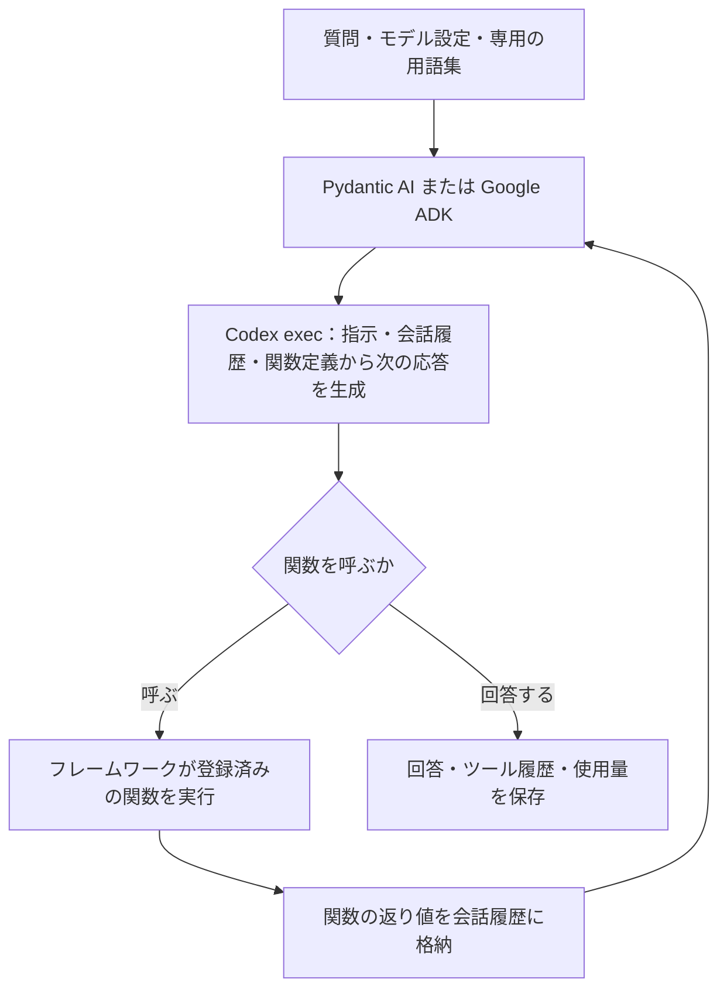
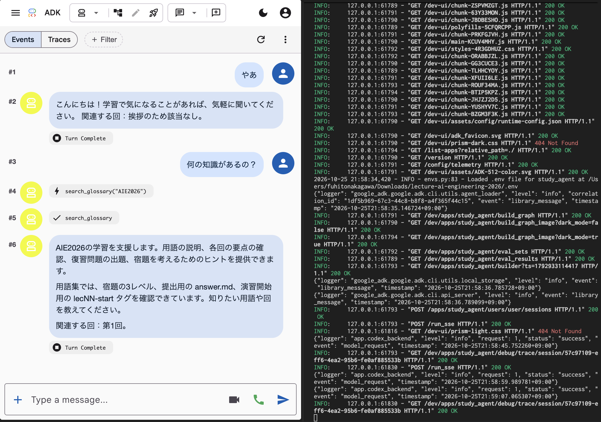
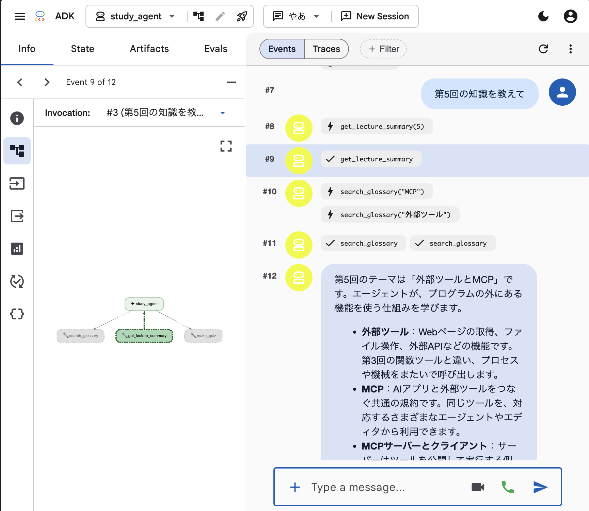
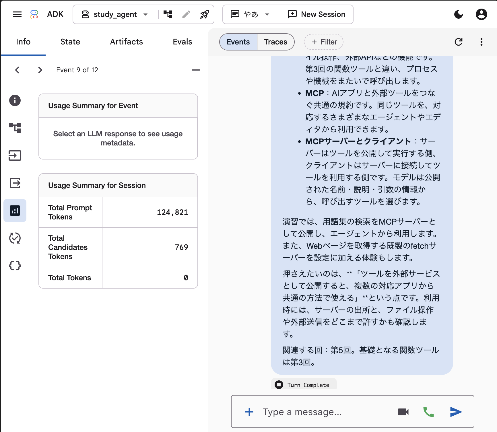

# 学習支援エージェントの比較

- [📋 1. 概要](#-1-概要)
- [🚀 2. 実行方法](#-2-実行方法)
- [⚙️ 3. 設定](#-3-設定)
- [📁 4. 構成](#-4-構成)
- [📊 5. 出力と観測](#-5-出力と観測)
- [🔐 6. 制約とログ](#-6-制約とログ)
- [🧪 7. テスト](#-7-テスト)

## 📋 1. 概要

同じCodexモデルと質問を使い、素の応答・Pydantic AI・Google ADKを比較するPythonプロジェクト。
用語検索、講義要約、確認問題の3ツールを共有する。コード・依存関係・設定・学習データ・テスト・実行結果は、このディレクトリに配置する。

モデル呼び出しはログイン済みのCodex CLIを使う。Gemini APIキーは不要で、モデルへのアクセスはCodexの契約とログイン状態に依存する。



## 🚀 2. 実行方法

### 2.1. 準備

Python 3.12以上、uv、ログイン済みのCodex CLIを使用する。
以下のコマンドは `adk_agents/` 内で実行する。

```bash
cd adk_agents
uv sync --frozen
test -f .env || cp .env.example .env
codex login status
```

### 2.2. 比較実験

```bash
AIE_AGENT_MODE=compare AIE_RUN_DIRECTORY=new uv run python -m src.main
```

4問を3方式でそれぞれ独立した会話として実行し、12ケースの回答とトレースを保存する。
質問の配列は `.env` の `AIE_EXPERIMENT_QUESTIONS` で指定する。

途中で失敗した実験は、`.env` の `AIE_RUN_DIRECTORY` に `output/` 配下の実行フォルダ名を指定して再開する。

```bash
AIE_AGENT_MODE=compare uv run python -m src.main
```

成功したケースは保存済みの回答を使用し、失敗・中断・未実行のケースを実行する。
失敗・中断したケースのファイルは `history/` に保持する。
モデル・推論の強さ・要求上限・CLIの版・質問が保存時と異なる場合は、同じ実験に混ぜずエラーになる。
同じ実験フォルダへの同時実行は `.run.lock` で拒否する。

### 2.3. 単独の質問

`.env` の `AIE_QUESTION` に質問を指定する。`AIE_TRACE=true` で関数名・引数・返り値・モデル要求回数を表示する。

```bash
AIE_AGENT_MODE=local uv run python -m src.main
AIE_AGENT_MODE=adk uv run python -m src.main
AIE_AGENT_MODE=plain uv run python -m src.main
```

ツール一覧の確認はモデルAPIを呼ばない。

```bash
AIE_AGENT_MODE=list_tools uv run python -m src.main
```

### 2.4. ADK Web

```bash
PYTHONPATH=. uv run adk web agents --host 127.0.0.1 --port 8765
```

ブラウザで `http://127.0.0.1:8765` を開き、`study_agent` を選択して質問する。
セッション内の回答、関数呼び出し、関数の返り値を比較の材料にする。
Web用のセッションと成果物は `.adk/` に保存され、Gitの管理対象外となる。

### 2.4.1. チャットと用語検索

`Events` には、利用者の質問、関数呼び出し、関数の返り値、最終回答が順に並ぶ。
下図では「何の知識があるの？」という質問に対して `search_glossary("AIE2026")` を呼び、学習支援の対象と関連する講義回を回答している。



### 2.4.2. ツールの実行順とグラフ

「第5回の知識を教えて」という質問では、`get_lecture_summary(5)` に続いて、`search_glossary("MCP")` と `search_glossary("外部ツール")` が呼ばれている。
イベントを選択すると、左側のグラフで対応するツールを確認できる。下図は講義要約の返却イベントを選び、`get_lecture_summary` が強調表示された状態。



### 2.4.3. トークン使用量

使用量の表示では、イベント単位とセッション単位の情報を区別する。
下図の `Usage Summary for Session` は、入力124,821トークン、出力769トークンというセッション全体の表示であり、1つの質問だけの使用量ではない。
イベント単位の使用量を見る場合は、対象のLLM応答イベントを選択する。



## ⚙️ 3. 設定

設定ファイルはこのディレクトリの `.env`。環境変数はファイルより優先される。
必要な設定が空または不正な場合は、モデル呼び出しの前にエラーになる。

| 環境変数 | 用途・制約 | 使用するモード |
| --- | --- | --- |
| `AIE_CODEX_MODEL` | Codexで使うモデル名 | 全モード |
| `AIE_CODEX_REASONING_EFFORT` | モデルが対応する推論の強さ | 全モード |
| `AIE_CODEX_TIMEOUT_SECONDS` | 1回の応答の制限時間。正の整数、秒単位 | 全モード |
| `AIE_CODEX_MAX_REQUESTS` | 1質問あたりのモデル要求数の上限。正の整数 | 全モード |
| `AIE_CODEX_MAX_ATTEMPTS` | 1つのモデル要求に対する最大試行回数。正の整数 | 全モード |
| `AIE_CODEX_RETRY_DELAY_SECONDS` | 再試行前の待機時間。正の整数、秒単位 | 全モード |
| `AIE_RUN_DIRECTORY` | `new` または再開する実行フォルダ名 | `compare` |
| `AIE_AGENT_MODE` | `compare` / `local` / `adk` / `plain` / `list_tools` | CLI |
| `AIE_QUESTION` | 空でない質問文 | `local` / `adk` / `plain` |
| `AIE_TRACE` | `true` / `false` | `local` / `adk` / `plain` |
| `AIE_EXPERIMENT_QUESTIONS` | 空でない質問文字列のJSON配列 | `compare` |
| `LOG_LEVEL` | `DEBUG` / `INFO` / `WARNING` / `ERROR` / `CRITICAL` | 全モード |

モデル、フレームワーク、テストツールの依存バージョンは `pyproject.toml` と `uv.lock` に固定する。
ADK 2.13.0の依存宣言の上限に対して、OpenTelemetry API/SDKは1.45.1を使用する。
これはトレースヘッダー解析の既知の脆弱性を避けるための制約である。

## 📁 4. 構成

```text
adk_agents/
├── .env                         # 個人の設定（Git管理外）
├── .env.example                 # 必須設定のテンプレート
├── .gitignore
├── README.md
├── pyproject.toml
├── uv.lock
├── agents/
│   └── study_agent/
│       ├── __init__.py
│       └── agent.py             # ADK Webのroot_agent
├── data/
│   ├── glossary.json            # 学習用の用語集
│   └── lectures/
│       ├── 01.md
│       ├── 02.md
│       ├── 03.md
│       └── 05.md
├── docs/
│   └── images/
│       ├── adk-chat-search.png   # チャットと用語検索
│       ├── adk-tool-flow.png     # ツール履歴とグラフ
│       └── adk-session-usage.png # セッションの使用量
├── src/
│   ├── __init__.py
│   ├── main.py                  # CLIのエントリポイント
│   ├── pipeline.py              # 比較実験と結果の保存
│   ├── agent.py                 # 共通の指示とPydantic AIのツール登録
│   ├── adk_agent.py             # ADKのエージェントとモデル変換
│   ├── codex_backend.py         # Codex呼び出しと応答の検証
│   ├── codex_errors.py          # エラー分類と本文を含めない診断情報
│   ├── codex_model.py           # Pydantic AIのモデル変換
│   ├── experiment_storage.py    # 実験の再開・ロック・失敗履歴
│   ├── tools.py                 # 用語検索・講義要約・確認問題
│   ├── config/
│   │   ├── __init__.py
│   │   ├── settings.py          # 専用の.envの読み込みと必須チェック
│   │   └── logging.py           # 相関ID付きの構造化ログ
│   └── utils/
│       ├── __init__.py
│       ├── artifacts.py         # JSONの保存
│       └── codex_cli.py         # CLIの版・JSONL・使用量の読み取り
├── tests/
│   ├── __init__.py
│   ├── helpers.py
│   ├── test_agent.py
│   ├── test_codex_backend.py
│   ├── test_experiment_storage.py
│   ├── test_isolation.py
│   ├── test_main.py
│   ├── test_pipeline.py
│   ├── test_tools.py
│   └── config/
│       ├── __init__.py
│       ├── test_logging.py
│       └── test_settings.py
└── output/
    └── YYYYMMDD-HHMMSS/         # 実行結果（JST）
```

## 📊 5. 出力と観測

比較結果はこのプロジェクトの `output/YYYYMMDD-HHMMSS/` に保存する。
同じ名前のフォルダが存在する場合は、上書きせずエラーになる。

| ファイル | 内容 |
| --- | --- |
| `settings.json` | 共通設定、質問一覧、Codex CLIの版 |
| `summary.json` | 各ケースの成否、時間、要求回数、関数名と引数 |
| `NN_MODE/answer.md` | モデルの最終回答 |
| `NN_MODE/trace.json` | 関数呼び出し・引数・返り値 |
| `NN_MODE/messages.json` | Pydantic AIの会話履歴、またはADKのイベント |
| `NN_MODE/model_requests.json` | Codexの各要求の成否、使用量、構造化出力 |
| `NN_MODE/result.json` | 1ケースの成否、時間、要求回数、エラー分類 |
| `NN_MODE/execution_settings.json` | 当該ケースの設定。待機時間と再試行設定を含む |
| `history/NN_MODE/連番/` | 再実行対象となった失敗・中断ケースのファイル |

`requests` はフレームワークからのモデル要求数。`cli_attempts` は再試行も含めたCodex execの起動回数。
`model_requests.json` の `attempts` に各試行の成否・時間・診断情報を残す。
タイムアウトした試行のトークン使用量は不明であり、ゼロとはみなさない。
Codex内部の非公開な通信回数は観測対象に含めない。
モデルの回答や使用量は実行結果だけを根拠とし、テスト用のダミー回答を実測に含めない。

## 🔐 6. 制約とログ

- **ツール**：登録された3関数だけをフレームワークが実行する。Codex自身の組み込みツールを使った応答は比較から除外する。
- **Codexの起動**：一時ディレクトリ・読み取り専用sandboxで実行する。CLIの起動権限、ログイン、モデル利用権限が必要。
- **再試行**：タイムアウト・通信切断・利用制限だけを最大試行回数まで再試行する。権限・認証・不正な応答の失敗は自動で繰り返さない。
- **エラー**：失敗理由と、最後に観測したイベントの種類を保存する。権限・認証・CLIの不足では実験を停止する。他のケース単位の失敗では残りのケースを実行し、最後に失敗があればエラーで終了する。
- **ログ**：標準エラーに1行JSONを出力する。JSTの時刻、logger名、レベル、相関IDを含める。許可した診断項目だけを出力し、例外の値はマスクする。
- **設定の保管**：個人の `.env` とWeb用のセッションはGitの管理対象外。

## 🧪 7. テスト

このディレクトリの仮想環境で、モデルAPIを呼ばずに検証する。

```bash
uv run pytest tests/ -q
```

- **ツールの正解**：指定回の用語と定義の一致、存在しない回の案内。
- **会話ループ**：両フレームワークでの関数呼び出し、返り値、次のモデル入力。
- **Codex接続**：JSON Schema、標準入力、読み取り専用sandbox、タイムアウト、起動権限、利用上限。
- **再試行と再開**：同じ入力での再試行、権限エラー時の停止、成功結果の保持、失敗履歴、実行条件の一致、同時実行の拒否。
- **設定の分離**：作業ディレクトリに依存しない専用.envの参照、必須値の不足、環境変数の優先。
- **ログ**：許可されていない本文や例外値を出力しないこと。
