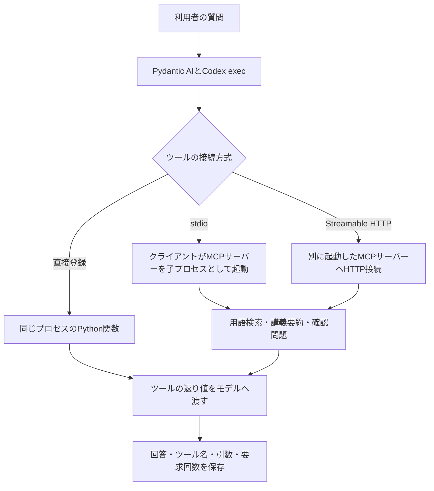

# MCP学習支援エージェント

- [📋 1. 概要](#-1-概要)
- [🚀 2. 共通演習の進め方](#-2-共通演習の進め方)
- [🔁 3. 基礎課題の比較](#-3-基礎課題の比較)
- [⚙️ 4. 設定](#-4-設定)
- [📊 5. 実行結果](#-5-実行結果)
- [📁 6. 構成](#-6-構成)
- [🧪 7. テストと制約](#-7-テストと制約)

## 📋 1. 概要

講座の用語検索・講義要約・確認問題をMCPサーバーとして公開し、直接登録、stdio、Streamable HTTPを比較する独立したuvプロジェクト。
サーバーはMCP Python SDKの `MCPServer`、クライアントはPydantic AIの `MCPToolset` と `fastmcp.Client` を使う。
モデルはログイン済みのCodex CLIを使い、既定の設定例は `gpt-6-luna`・推論 `low`。Gemini APIキーは不要。

lec03のツール、用語集、Codex接続は、このプロジェクト内に配置する。
`make_quiz` も公開するが、宿題の比較対象は基礎レベルの通信方式と説明文。



## 🚀 2. 共通演習の進め方

### 2.1. 環境

以下は `mcp_agents/` 内で実行する。

```bash
cd mcp_agents
uv sync --frozen
test -f .env || cp .env.example .env
```

ツール一覧とMCP通信だけの検証は、モデルのAPIキーやCodexログインを使わない。
モデルに質問する場合は、ログイン済みのCodex CLIがPATH上に必要。

```bash
codex login status
```

### 2.2. 直接登録とMCPの一覧

```bash
MCP_ACTION=inspect MCP_CLIENT_MODE=direct uv run python -m src.main
MCP_ACTION=inspect MCP_CLIENT_MODE=mcp MCP_CONFIG_FILE=config/stdio.json uv run python -m src.main
```

直接登録では `search_glossary`、`get_lecture_summary`、`make_quiz` の3つ。
MCP経由では `glossary_search_glossary` など、設定ファイルのサーバー名が接頭辞になる。
名前・docstringに由来する説明・引数のJSON Schemaを表示し、`output/` に保存する。

### 2.3. 同じ質問を直接登録とstdioで比較

`.env` の `MCP_QUESTION` に質問を指定する。

```bash
MCP_ACTION=ask MCP_CLIENT_MODE=direct uv run python -m src.main
MCP_ACTION=ask MCP_CLIENT_MODE=mcp MCP_CONFIG_FILE=config/stdio.json uv run python -m src.main
```

例は「AIE2026の講座の宿題にある『3レベル』とは何ですか？」。
回答、`trace.json` のツール名と引数、`requests` を比較する。

講義要約の確認は、`MCP_QUESTION` を「第2回では何を学びますか？」にして実行する。
MCP経由の公開名は `glossary_get_lecture_summary`。

### 2.4. 既製のfetchサーバー

`config/fetch.json` は、用語集サーバーの設定に既製の `mcp-server-fetch` を加えたファイル。
Pythonコードを変更せず、設定ファイルの選択で利用できるツールが増える。

```bash
MCP_ACTION=inspect MCP_CLIENT_MODE=mcp MCP_CONFIG_FILE=config/fetch.json uv run python -m src.main
```

一覧には `fetch_fetch` が加わる。サーバーパッケージは `pyproject.toml` と `uv.lock` に固定し、`uv run mcp-server-fetch` で起動する。

```bash
MCP_ACTION=ask MCP_CLIENT_MODE=mcp MCP_CONFIG_FILE=config/fetch.json \
MCP_QUESTION='https://modelcontextprotocol.io/docs/getting-started/intro.md の冒頭を日本語で3行に要約して' \
uv run python -m src.main
```

この例は公式サイトのMarkdown版ページを対象とする。
既製サーバーのHTML本文抽出にはNode.jsとreadabilipyの補助処理が必要で、npmキャッシュへの書き込み権限も必要となる。
Markdown版ではHTML変換を伴わず、取得したテキストをモデルへ渡せる。

### 2.5. 実装課題：確認問題の入力検証

`make_quiz` は整数の講義回を受け取る。収録された回は問題と正解を返し、未収録の回は利用可能な回の案内を返す。
文字列や真偽値は整数へ変換せず、MCPの型エラーとする。

```bash
MCP_ACTION=verify_quiz uv run python -m src.main
```

この操作は実際のstdioサーバーに接続するが、モデルAPIは呼ばない。
`TestModel` で正常な回と未収録の回、`FunctionModel` で型不正の入力を指定し、モデルに届くメッセージを `quiz_validation.json` に保存する。

| 入力 | MCPの応答 | モデルに渡るメッセージ |
| --- | --- | --- |
| `lecture=2` | 問題と正解、`isError=false` | `ToolReturnPart` |
| `lecture=99`などの未収録回 | 利用可能な回の案内、`isError=false` | `ToolReturnPart` |
| 文字列・真偽値 | 型検証エラー、`isError=true` | `RetryPromptPart` |

自然言語の回答を確認する場合は、単独質問を使う。

```bash
MCP_ACTION=ask MCP_QUESTION='第2回の内容から確認問題を1問出して' uv run python -m src.main
MCP_ACTION=ask MCP_QUESTION='第99回の内容から確認問題を1問出して' uv run python -m src.main
```

## 🔁 3. 基礎課題の比較

### 3.1. Streamable HTTPのサーバー

1つ目のターミナルで、HTTPサーバーを起動する。

```bash
MCP_TRANSPORT=streamable-http MCP_DESCRIPTION_STYLE=brief uv run python -m src.server
```

`.env` の例では `127.0.0.1:8767` の `/mcp` で待ち受ける。
別のターミナルで、このプロジェクトのディレクトリから次を実行する。

```bash
MCP_ACTION=inspect MCP_CLIENT_MODE=mcp MCP_CONFIG_FILE=config/http.json uv run python -m src.main
MCP_ACTION=ask MCP_CLIENT_MODE=mcp MCP_CONFIG_FILE=config/http.json uv run python -m src.main
```

| 観点 | stdio | Streamable HTTP |
| --- | --- | --- |
| サーバーの起動 | クライアントが設定のコマンドを実行 | 利用者が別のターミナルで起動 |
| 通信路 | 子プロセスの標準入力・標準出力 | `http://127.0.0.1:8767/mcp` |
| 待ち受けポート | 不要 | 必要 |
| サーバーの寿命 | クライアントの接続終了に伴い終了 | クライアントの処理が終わっても待ち受ける |
| モデルから見える名前 | `glossary_` 付き | 同じく `glossary_` 付き |

HTTPサーバーの端末には、通信方式とサーバーのPIDを含むJSONログを出力する。
作業の終了時はサーバーのターミナルで `Ctrl+C` を押す。

### 3.2. docstringの比較

講義要約の処理・公開名・引数名・型を同じにして、docstringを2種類用意する。
短い説明は「指定した回の資料を返す」。詳しい説明には質問例、使用目的、他ツールとの役割の違いを含める。
説明文は `src/profiles.py` の関数にある。

```bash
MCP_ACTION=inspect MCP_CLIENT_MODE=mcp MCP_CONFIG_FILE=config/stdio.json uv run python -m src.main
MCP_ACTION=inspect MCP_CLIENT_MODE=mcp MCP_CONFIG_FILE=config/stdio_detailed.json uv run python -m src.main
```

同じ「第2回では何を学びますか？」を両方へ質問し、呼ばれたツール、引数、要求回数、回答を比べる。
説明を詳しくしても挙動が変わらない場合は、その結果も観察として記録する。

### 3.3. 6ケースをまとめて実行

HTTPサーバーを起動した状態で実行する。

```bash
MCP_ACTION=compare AIE_RUN_DIRECTORY=new uv run python -m src.main
```

| ケース | 接続・説明 | 質問 |
| --- | --- | --- |
| `01_direct` | 直接登録・短い説明 | 宿題の3レベル |
| `02_stdio` | stdio・短い説明 | 同じ質問 |
| `03_http` | HTTP・短い説明 | 同じ質問 |
| `04_brief` | stdio・短い説明 | 第2回の学習内容 |
| `05_detailed` | stdio・詳しい説明 | 同じ質問 |
| `06_fetch` | 用語集＋fetch | 公式Markdownページの要約 |

失敗した実験の再開には、`.env` の `AIE_RUN_DIRECTORY` に対象の実行フォルダ名を指定する。
成功したケースは再利用し、失敗・中断したケースのファイルを `history/` に保持する。

```bash
MCP_ACTION=compare uv run python -m src.main
```

モデル・推論設定・要求上限・CLIの版・質問・接続設定が保存時と異なる場合は、同じ実験への混在を拒否する。
docstringやデータを編集して比較する場合は、新しい実験を使う。

## ⚙️ 4. 設定

このプロジェクトの `.env` を読み、同名の環境変数を優先する。
必要な値の不足・不正は起動時にエラーにする。APIキーは設定ファイルへ記載しない。

| 変数 | 用途 |
| --- | --- |
| `MCP_ACTION` | `inspect` / `ask` / `compare` / `verify_quiz` |
| `MCP_CLIENT_MODE` | `direct` / `mcp` |
| `MCP_CONFIG_FILE` | `config/` 内の接続設定 |
| `MCP_DESCRIPTION_STYLE` | 直接登録・自作サーバーの説明。`brief` / `detailed` |
| `MCP_TRANSPORT` | 自作サーバーの `stdio` / `streamable-http` |
| `MCP_HTTP_HOST` / `MCP_HTTP_PORT` | HTTPの待ち受け。URL設定と対応させる |
| `MCP_TIMEOUT_SECONDS` | MCPの接続・応答の制限時間 |
| `MCP_QUESTION` | 単独実行の質問 |
| `AIE_CODEX_MODEL` / `AIE_CODEX_REASONING_EFFORT` | モデルと推論の強さ |
| `AIE_CODEX_TIMEOUT_SECONDS` / `AIE_CODEX_MAX_REQUESTS` | Codex応答の制限時間と1質問の要求上限 |
| `AIE_CODEX_MAX_ATTEMPTS` / `AIE_CODEX_RETRY_DELAY_SECONDS` | 一時的な通信失敗の最大試行回数と待機時間 |
| `AIE_RUN_DIRECTORY` | `new` または再開対象のフォルダ名 |
| `LOG_LEVEL` | 自作クライアント・サーバーのログレベル |

## 📊 5. 実行結果

出力先は `output/YYYYMMDD-HHMMSS/`。同じフォルダ名がある場合は上書きしない。

- **一覧表示**：`tools.json` にモデルが受け取る名前・説明文・引数を保存する。
- **比較実験**：`settings.json`、`plan.json`、`summary.json` に共通条件・接続設定・各ケースの成否を保存する。
- **各ケース**：`tools.json`、`answer.md`、`trace.json`、`messages.json`、`model_requests.json`、`execution_settings.json`、`result.json` を保存する。
- **実装検証**：`quiz_validation.json` に実MCPの返却とテスト用モデルのtraceを保存する。`real_llm_used=false` を明示する。
- **要求回数**：`requests` はフレームワークのモデル要求数、`cli_attempts` は再試行を含むCodex execの起動数。MCPの通信回数とは異なる。
- **成否**：回答の取得に成功したことと、正しいツール・内容で回答できたことを分けて評価する。失敗結果やテスト用のモデル応答を成功した実測値へ置き換えない。

## 📁 6. 構成

```text
mcp_agents/
├── .env                         # 個人設定（Git管理外）
├── .env.example
├── .gitignore
├── README.md
├── pyproject.toml
├── uv.lock
├── config/
│   ├── stdio.json               # 子プロセス・短い説明
│   ├── stdio_detailed.json      # 子プロセス・詳しい説明
│   ├── http.json                # HTTP接続
│   └── fetch.json               # 用語集と既製fetch
├── data/
│   ├── glossary.json
│   └── lectures/
│       ├── 01.md
│       ├── 02.md
│       ├── 03.md
│       └── 05.md
├── src/
│   ├── __init__.py
│   ├── main.py                  # クライアントの入口
│   ├── server.py                # MCPサーバーの入口
│   ├── client.py                # 接続設定・ツール一覧
│   ├── pipeline.py              # 質問・比較・結果保存
│   ├── profiles.py              # docstringの比較条件
│   ├── quiz_validation.py       # 確認問題の正常・異常入力の観測
│   ├── tools.py                 # 3つの学習支援ツール
│   ├── codex_backend.py         # Codex CLIの呼び出し
│   ├── codex_model.py           # Pydantic AIのモデル変換
│   ├── codex_errors.py          # 失敗分類
│   ├── experiment_storage.py    # 再開・履歴・実行ロック
│   ├── config/
│   │   ├── __init__.py
│   │   ├── settings.py          # 必須環境設定
│   │   └── logging.py           # JSONログ
│   └── utils/
│       ├── __init__.py
│       ├── artifacts.py         # JSON保存
│       └── codex_cli.py         # CLIの版とイベント解析
├── tests/
│   ├── __init__.py
│   ├── conftest.py
│   ├── helpers.py
│   ├── test_codex_backend.py
│   ├── test_mcp.py
│   ├── test_pipeline.py
│   ├── test_quiz_mcp.py
│   ├── test_tools.py
│   └── config/
│       ├── __init__.py
│       ├── test_logging.py
│       └── test_settings.py
└── output/
    └── YYYYMMDD-HHMMSS/
```

## 🧪 7. テストと制約

```bash
uv run pytest tests/ -q
```

- **MCP通信**：実際のstdio子プロセスとローカルHTTPサーバーを使い、同じ定義・講義要約が返ることを確認する。
- **モデルへの受け渡し**：APIを使わないテスト用モデルで、MCPの関数呼び出しと返り値を検証する。
- **確認問題の入力**：正常な回、未収録の回、0、負数、文字列、真偽値を検証し、通常の案内とMCPエラーを区別する。
- **説明文**：公開名・引数の型を維持し、短い説明と詳しい説明の差を確認する。
- **外部サーバー**：fetch用設定からツールが増えることを確認する。テストは外部Webサイトの応答には依存しない。
- **モデル接続**：タイムアウト・権限・不正出力を区別し、成功と混在させない。
- **通信路**：自作サーバーの標準出力はstdioのプロトコル専用。ログは相関ID付きのJSONで標準エラーへ出力する。
- **公開範囲**：HTTPはループバックで待ち受ける。fetchには秘密情報や個人情報を含むURLを渡さない。
